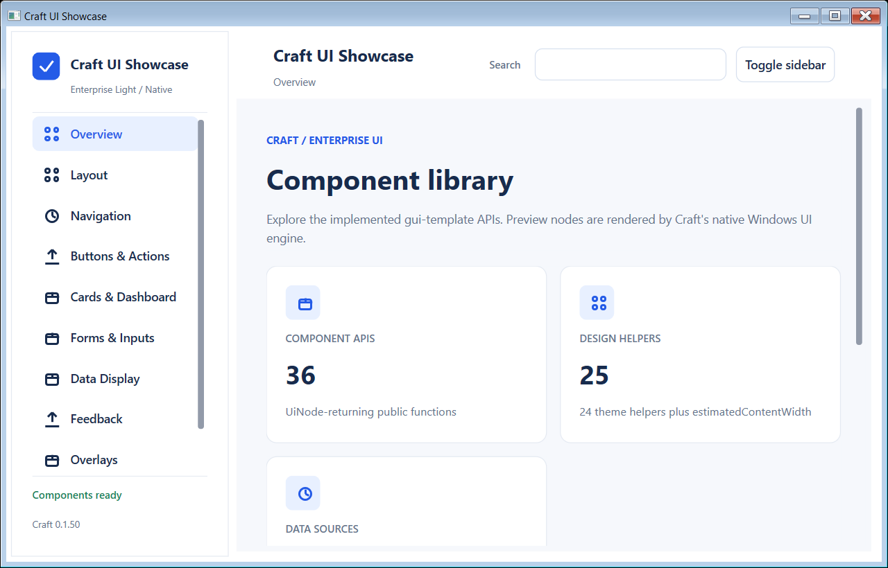

# Craft UI Showcase

A native Windows gallery for the **implemented** `packages/gui-template` 0.1.50 API. The application is written in Craft and composes `packages/gui` with `packages/gui-template`. It uses mock data only; there is no database, HTTP service, React, WebView, or browser runtime.



## Requirements and setup

- Windows and Craft 0.1.50.
- A local Craft source checkout next to this repository. The path dependencies in [craft.toml](craft.toml) expect `../craft/packages/gui` and `../craft/packages/gui-template`.
- The `craft` checkout must include `gui-template` 0.1.50. At the time of this README update, those package changes exist in the local Craft checkout and have **not yet been pushed to its GitHub repository**. A fresh clone of the published `craft` repository may therefore need a newer revision before this project can run.

From `D:\02-Repository\craft-ui`:

```powershell
craft package lock
craft check
craft test
craft run
```

If `craft` on PATH is older, use `D:\02-Repository\craft\dist\craft.exe` for these commands. `craft build` creates `dist/craft-ui-showcase.craftbundle`, a source bundle run by Craft 0.1.50; it is not a standalone executable or installer. The `dist/` directory is excluded from Git.

## What's available

The [component registry](REGISTRY.md) is generated from the real package exports. It records **61 public functions**: **36 UiNode component APIs** and **25 design/layout helpers** (24 theme helpers plus `estimatedContentWidth`). The gallery groups the UiNode APIs under Layout, Navigation, Buttons & Actions, Cards & Dashboard, Forms & Inputs, Data Display, and Responsive. Feedback and Overlays explicitly show **Planned** because the package has no exported components in those categories.

Each component card shows its native live preview, exact signature, example Craft call, supported variants/states, responsive behavior, and known limits. The `shell` and `shellAdaptive` cards render constrained nested previews; the application itself also uses `shellAdaptive`.

| Template API | Current limit |
|---|---|
| `formGrid` | Lays out fields supplied by the app; actual inputs come from `packages/gui`. |
| `tableViewport` | Scroll wrapper, not a `dataTable`. |
| `splitButton` | Adjacent actions without a popup menu. |
| `toggleSwitch` | Button labeled On/Off; the app owns the boolean state. |
| Narrow sidebar | Stacked panel, not a floating overlay. |

## Explore and verify

1. Select categories in the sidebar. The active state and last event should update. On wide windows, search from the application header; below 900 logical px, use the page search field. Search covers all categories.
2. Try the button variants, disabled button, icon actions, tabs, toggle, navigation items, form inputs, and **Change mock value** in the `statCard` entry.
3. Resize through 1200, 900, and 650 logical px. The sidebar should move between expanded, compact, and narrow modes. In narrow mode, **Menu** opens the category list. Selected category and input values are kept in application state.
4. Check Windows display scales of 100%, 125%, and 150%, including clipping, scrolling, focus, and keyboard activation. Overview reports the logical viewport width and layout mode.

The most recent local validation completed `craft check`, `craft test` (**3 passed**), `craft build`, and a native launch. Visual checks covered an expanded window and a narrow window with category navigation at **125% DPI**. The captures in [screenshots](screenshots) are manual regression references. Automated pixel comparison and visual checks at 100%/150% DPI have not been performed.

## Source layout

- [src/main.craft](src/main.craft): window, responsive shell, state, and event loop.
- [src/registry.craft](src/registry.craft): component names, categories, signatures, and examples.
- [src/previews.craft](src/previews.craft): native UiNode previews using real template calls.
- [src/gallery.craft](src/gallery.craft): gallery cards, search, status, and limitations.
- [tools/generate_registry.py](tools/generate_registry.py): regenerates `REGISTRY.md` from the actual `gui-template` exports.
- [tests/registry.craft](tests/registry.craft): registry count, planned category, and preview construction checks.
